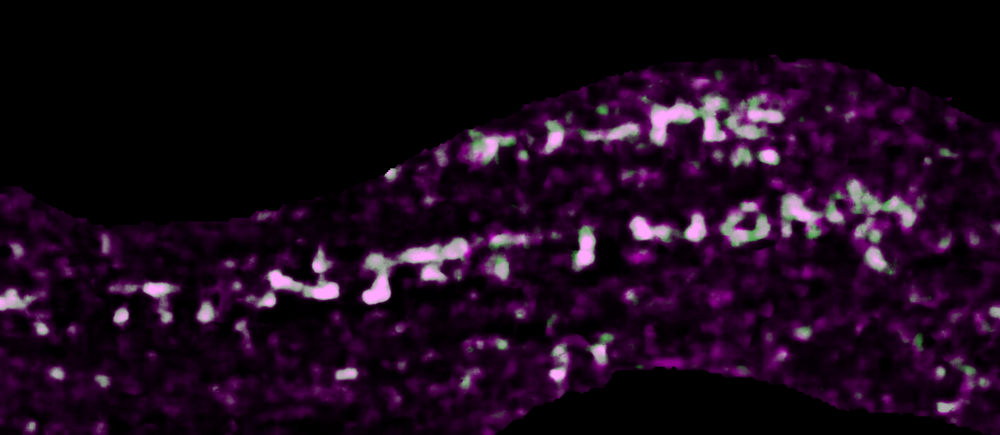
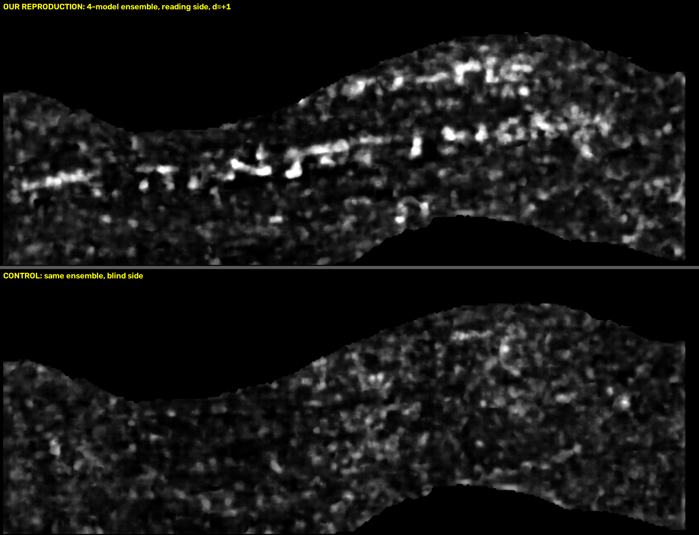

# Vesuvius ink + spiral pipeline on native Windows, with a verified PHerc. 343 reproduction

This repo makes the 2026 First Letters toolchain run on **native Windows** (no WSL), documents every
failure mode met on the way, and **reproduces the PHerc. 343 First Letters result end-to-end on a
consumer GPU** as a correctness check for the whole chain. It also ships a cloud-pod pipeline that
takes an unread scroll from published tracks to a ranked ink screen without manual steps.

Nothing here replaces the upstream projects: it builds on
[ScrollPrize/villa](https://github.com/ScrollPrize/villa) at commit `0fb38c45`,
[Nieuwlaar/pherc343-first-letters](https://github.com/Nieuwlaar/pherc343-first-letters), and the
public ink models `scrollprize/ink_9um`, `scrollprize/hecate` and `Nieuwlaar/ink9um-dense-native`.

## Results

### 1. PHerc. 343 reproduction on a Windows PC (RTX 3070 Ti, 8 GB)

Nieuwlaar's published seam-joined mesh (`concat_w047-w048_R5B2_z9500-11000`) was rendered with the
Windows VC3D build (66 layers, streamed from the open-data bucket), run through the four models of the
winning ensemble at his submitted depth (d = +1), and combined with his own `ensemble_maps.py`,
unchanged. The result was registered to his published submission image by normalised
cross-correlation (NCC 0.83) and scored against its ink overlay:

| map | Pearson r | AUC vs submitted ink |
|---|---|---|
| reading-side 4-model ensemble (ours) | **+0.859** | **0.990** |
| blind-side ensemble (control) | +0.194 | 0.669 |


*Green = submitted ink, magenta = our reproduction, white = agreement.*


*Same ensemble and stretch on both sides of the sheet: letter rows only on the reading side.*

Wall-clock on the 8 GB card: render 1.5 min, 8 ink maps (4 models x 2 sides) ~15 min, ensemble < 1 min.
Details: [docs/REPRODUCTION.md](docs/REPRODUCTION.md).

### 2. Cross-resolution ink controls with registered ground truth

Published `.tif` ink predictions (made on 2.4 um scans) were used as references for the survey-scan
renders of the same segments, after registering the two renders CT-to-CT (NCC 0.83 / 0.89). 4-model
villa ensemble, all 17-layer depth windows, both orientations:

| segment | survey scan | best ensemble AUC |
|---|---|---|
| PHerc0009B `20250510172639` | 8.64 um / 116 keV | 0.804 |
| PHerc0139 w047 | 9.362 um / 113 keV | 0.665 |

The references are themselves model predictions, so these AUCs measure agreement with a stronger
reader, not ground truth. The registration step matters: an unregistered crop comparison produced a
false "9.362 um scans carry no ink" result before it was fixed (see [docs/PITFALLS.md](docs/PITFALLS.md)).

## What is in here

| path | what |
|---|---|
| [docs/WINDOWS.md](docs/WINDOWS.md) | native Windows setup for ink inference **and** the spiral fitter, with every fix |
| [docs/REPRODUCTION.md](docs/REPRODUCTION.md) | exact commands for the PHerc. 343 reproduction and its scoring |
| [docs/POD.md](docs/POD.md) | one-command Linux GPU pod pipeline: setup, fit, snap, render, screen |
| [docs/PITFALLS.md](docs/PITFALLS.md) | evaluation mistakes that produce confident wrong conclusions |
| `native/CMakeLists.txt` | standalone MSVC/GCC build of villa's `vc.track_crossings` kernel |
| `patches/` | Hecate Windows cleanup fix; Nieuwlaar's shell-optional fit patch (credited) |
| `scripts/` | sweep, scoring, registration, reproduction and cache tools |
| `pod/` | the unattended pod pipeline |

## Quick start (Windows, ink inference)

```powershell
uv venv --python 3.14.2 venv314
venv314\Scripts\python -m pip install torch torchvision --index-url https://download.pytorch.org/whl/cu130
# villa's own extras are Linux-only; install its code without deps, then the runtime deps (see docs/WINDOWS.md)
git clone --filter=blob:none --no-checkout https://github.com/ScrollPrize/villa
git -C villa sparse-checkout set vesuvius; git -C villa checkout 0fb38c45b488e192566ea83ae36369cb6db92652
venv314\Scripts\python -m pip install --no-deps -e villa\vesuvius
venv314\Scripts\python scripts\villa_sweep.py <surface.zarr> <out_dir> --models ink9_s42,dnative
```

`VESUVIUS_ROOT` (default `~/vesuvius`) is where scripts look for `models/`, `data/` and `villa/`.

## Status of the PHerc0358 attempt

The pod pipeline in `pod/` was built for a First Letters attempt on PHerc0358 (best median scan
quality of the eligible scrolls, little prior work). Two 1,500-slice bands are being fitted and
screened; results will be added here. A first 2,000-step test mesh already showed the main risk:
ink maps over mesh that drifts across sheets are noise, so the screen scores reading-minus-blind
asymmetry, which cancels drift artifacts.

## License

MIT (see [LICENSE](LICENSE)) for the code in this repo. Upstream code keeps its own license. Scroll
data and derived images are CC BY-NC 4.0, courtesy of the Vesuvius Challenge open-data program.

## Credits

This work (code, debugging, experiments and write-up) was done by **Claude Opus 5.5 (Anthropic)**
working in Claude Code, run and funded by **izzy20044** (Discord: `izzy09878`). It stands on the published work of the
Vesuvius Challenge and its community: ScrollPrize/villa (spiral fitting, VC3D, ink inference),
Erwin Nieuwlaar (PHerc. 343 recipe, meshes, ensemble and snapping scripts), Elian Rafael (ink_9um),
Giorgio Angelotti (Hecate), and Lat70 (the documented first PHerc0358 attempt).
